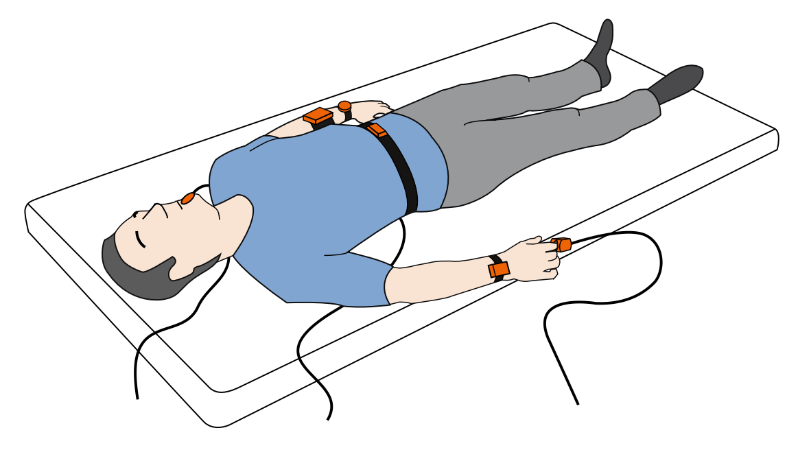

# Heart Rate Estimation from Inertial Measurements (SCG / BCG)

*Laboratory of Computational Physics, Module B
*Physics of Data, Università degli Studi di Padova

  

Ballistocardiography (BCG) and seismocardiography (SCG) are both non-invasive techniques used to monitor the human heart, based on its mechanical activity. These techniques record the micromovements induced by cardiovascular activity at the body’s center of mass and on the chest. In this project we estimate the heart rate of a healthy subject from linear-acceleration and angular-velocity signals recorded with the *MuSe* inertial measurement unit (IMU) by 221e. 

According to the guidelines of this project, two datasets are analysed: the mandatory *centre-of-sternum* and a second one selected among five alternative sensor placements on the basis of a comparative statistical analysis.

The notebook used for the presentation of this project is in this repository under the name HRE-G3.ipynb

## Authors

| Member | Main contribution |
|---|---|
| [Gabriela Landinez](https://github.com/gabriela-landinez) | FFT implementation |
| [Andrés Rojas](https://github.com/androjaslo) | Filter implementation; BPM and heart-rate-variability histograms |
| [Polina Gridiaeva](https://github.com/polinagridiaeva) | Statistical analysis and PCA |
| [Melissa Nespeque](https://github.com/melissanespeque) | Exploratory analysis of all datasets |

All members contributed to the bibliographic review, the interpretation of results and the writing of the final notebook.
